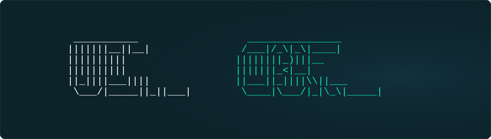

  

# UltiCore

UltiCore is a self-hosted platform for human-agent collaboration, built to give people and autonomous agents a shared place to work on their own infrastructure.

The project brings together persistent agent environments, shared project files, task handoffs, and live computer sessions that a person can join when an agent needs help. It combines Ubuntu Server with agent runtimes and tools for credential management, browser automation, and remote desktops.

## What I'm building

- Persistent agent workspaces with their own files, tools, and service access.
- Task assignment and review through Slack and a shared project workflow.
- Live agent computer sessions that people can view and control.
- Context management across sessions, scheduled automation, and server operations.

UltiCore is under active development. The complete installation package and integrations are still in progress.

## Source code and release plans

Development is currently private. An open-source release is planned for a later stage; no release date has been set.

This repository is the public project overview. Release announcements and the source-code link will be posted here when available. Watch this repository for updates.

## Author

Built by [Mads Iversen Feiring](https://github.com/numeono).
